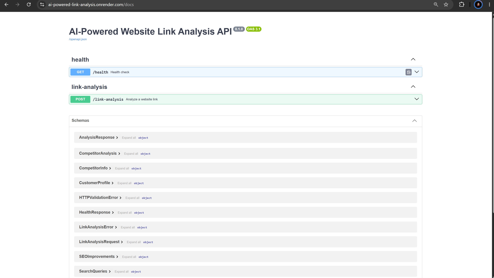
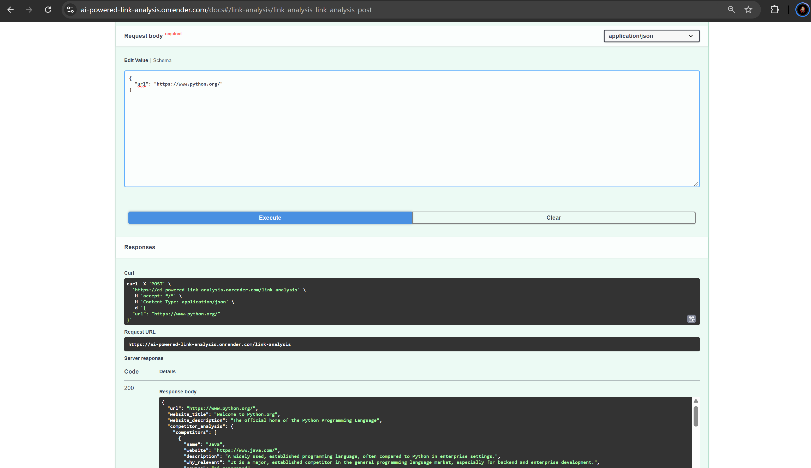
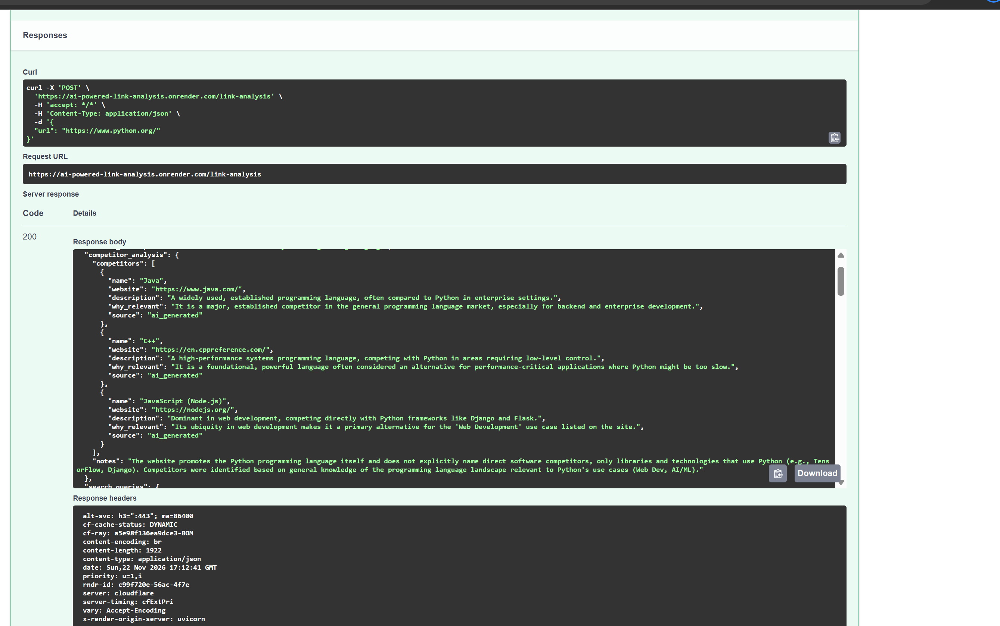
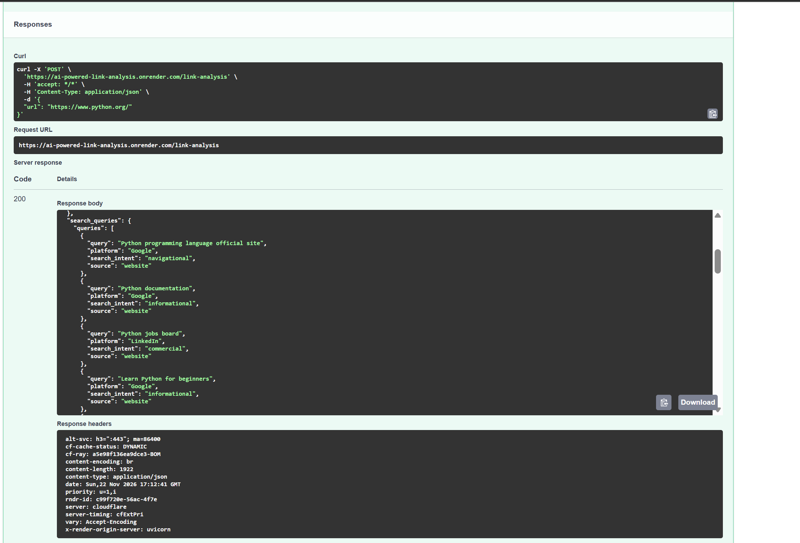
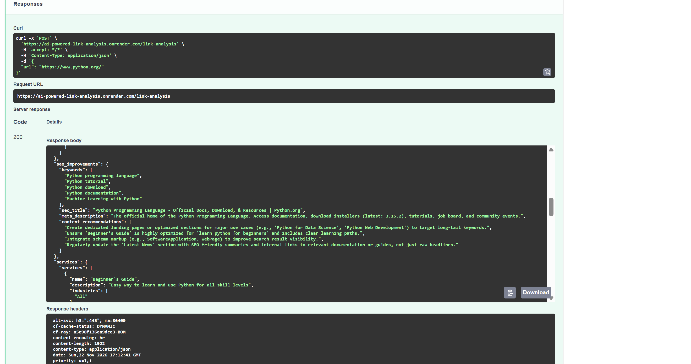
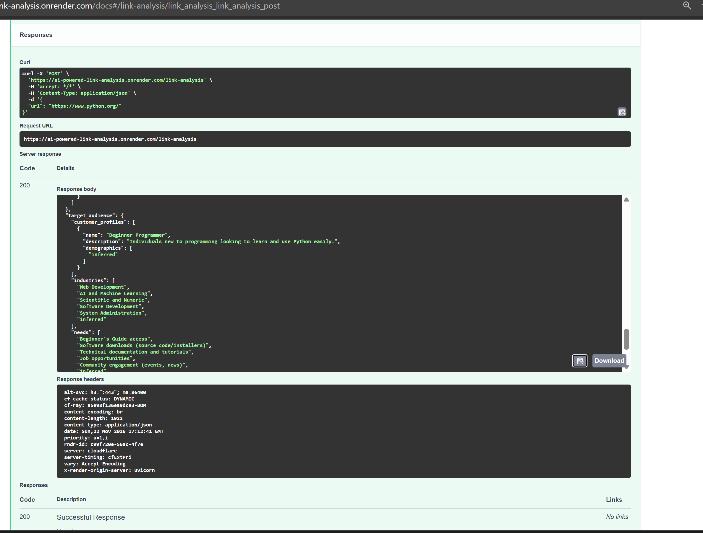
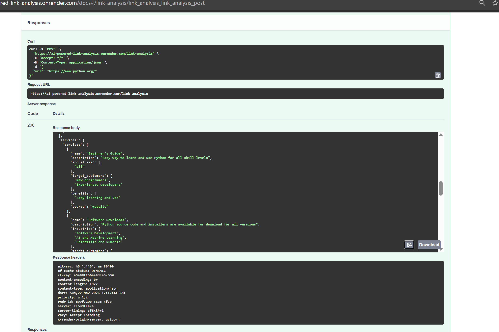
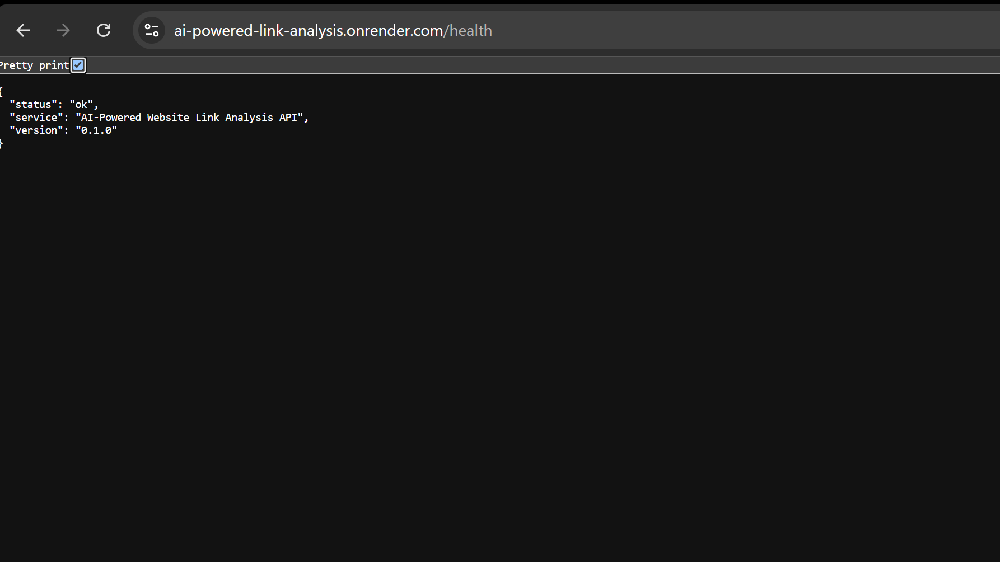

# ai-powered-link-analysis

AI-powered website analysis API built with Python, FastAPI, and LLMs. The service accepts a public URL, safely fetches and extracts its content, and returns structured analysis across five sections: competitor analysis, target search queries, SEO improvements, services offered, and target audience.

## Live deployment (submission)

The application is deployed and publicly accessible. Reviewers can test the API directly through the live Swagger UI without running anything locally.

| Resource | URL |
|----------|-----|
| Live Application | https://ai-powered-link-analysis.onrender.com/ |
| Swagger Documentation | https://ai-powered-link-analysis.onrender.com/docs |
| API Endpoint | https://ai-powered-link-analysis.onrender.com/link-analysis |
| Health Check | https://ai-powered-link-analysis.onrender.com/health |

### Testing the API with Swagger UI

1. Open the [Swagger Documentation](https://ai-powered-link-analysis.onrender.com/docs).
2. Locate `POST /link-analysis` and click **Try it out**.
3. Provide a request body such as:

   ```json
   {
     "url": "https://example.com/"
   }
   ```

4. Click **Execute** to receive a structured `AnalysisResponse` with competitor, search-query, SEO, services, and target-audience sections.
5. Open `GET /health` to confirm the service is running.

---

## What is included

- FastAPI application entry point (`app/main.py`), served on port **4000**.
- `GET /health` health-check endpoint.
- `POST /link-analysis` endpoint that runs the full analysis pipeline.
- Environment-based configuration via `pydantic-settings`.
- Pydantic request and response schemas.
- Separate API routes, services, schemas, and utilities packages.
- Reusable public URL validation with SSRF protections.
- Safe website fetching with SSRF protections, HTML-only content checks,
  streamed response-size limits, and bounded manual redirects.
- HTML content extraction with metadata, headings, cleaned text, boilerplate
  removal, and a configurable text-length limit.
- Five-section LLM analysis (competitors, search queries, SEO, services,
  target audience) using NVIDIA NIM with Pydantic schema validation.
- Competitor-entry normalization safeguard that removes placeholder or
  invalid names before validation.
- Pytest test suite.
- `.env.example`, `.gitignore`, and pinned `requirements.txt`.

## Key capabilities

| Capability | Detail |
|------------|--------|
| URL validation | Accepts only HTTP/HTTPS on default ports; rejects local, private, metadata, and reserved hostnames; resolves DNS once and confirms every address is public. |
| Safe fetching | IP-pinned transport connects only to validated addresses; redirects disabled by default and validated manually; only `text/html` accepted; response size capped. |
| HTML extraction | Extracts title, meta description, headings, and cleaned visible text; removes boilerplate, scripts, styles, and hidden content; caps text length. |
| Competitor analysis | Identifies up to 5 competitors (website-confirmed and AI-generated) with `source` attribution; normalizes away placeholder names. |
| Search queries | Identifies exactly 5 target queries with platform, intent, and source. |
| SEO improvements | Recommends keywords, SEO title, meta description, and content recommendations. |
| Services | Identifies up to 5 services with industries, target customers, and benefits. |
| Target audience | Identifies customer profiles, industries, needs, challenges, and geography. |

## Technology stack

- **Python 3.11+** (verified with Python 3.13)
- **FastAPI** 0.165.0 — web framework and request validation
- **Uvicorn** 0.54.0 — ASGI server
- **pydantic-settings** 2.16.3 — environment-based configuration
- **httpx2** 2.16.2 — asynchronous HTTP client for LLM and fetching
- **beautifulsoup4** 4.15.0 — HTML parsing and extraction
- **pytest** 9.2.0 — test framework
- **NVIDIA NIM** — LLM provider via OpenAI-compatible Chat Completions API (`integrate.api.nvidia.com/v1`, integrated model `nvidia/nemotron-3.5-bolt-e4b`)

Only NVIDIA NIM is integrated as the LLM provider. The `LLMClient` accepts `base_url`, `model`, and `api_key` as constructor parameters, but switching providers is not guaranteed to work through environment variables alone; provider compatibility must be tested before any change.

## Architecture and request-processing flow

The `POST /link-analysis` endpoint runs a five-stage pipeline:

1. **Validate URL** — `validate_public_url()` performs syntax checks, hostname normalization, DNS resolution, and public-IP confirmation with SSRF protections.
2. **Fetch HTML** — `fetch_html()` retrieves the page through an IP-pinned transport, with manual redirect validation, content-type gating, and response-size limits.
3. **Extract content** — `extract_content()` parses the HTML and produces title, description, headings, and cleaned visible text (capped at `EXTRACT_MAX_TEXT_CHARS`).
4. **Analyze** — `AnalysisService.analyze_page()` makes five sequential LLM calls (competitors, search queries, SEO, services, audience), each validated against a Pydantic schema.
5. **Respond** — Returns an `AnalysisResponse` containing all five sections plus `analysis_notes`.

Exception handling is layered: validation errors become `400`, fetch failures become `502`/`504`, LLM errors become `502`/`503`, and analysis/schema failures become `500`. Internal exception details are never leaked to the client; clients receive a structured `LinkAnalysisError` with `error` and `code` fields.

### Project structure

```
.
├── app/
│   ├── __init__.py
│   ├── main.py                 # FastAPI app factory and entry point
│   ├── api/
│   │   ├── __init__.py
│   │   └── routes/
│   │       ├── __init__.py
│   │       ├── health.py       # GET /health
│   │       └── link_analysis.py # POST /link-analysis
│   ├── core/
│   │   ├── __init__.py
│   │   └── config.py           # Environment-based settings (pydantic-settings)
│   ├── schemas/
│   │   ├── __init__.py
│   │   ├── analysis.py         # AnalysisResponse and five section schemas
│   │   ├── health.py           # HealthResponse model
│   │   └── link_analysis.py    # LinkAnalysisRequest / LinkAnalysisError
│   ├── services/
│   │   ├── __init__.py
│   │   ├── analysis.py         # Five-section LLM analysis engine
│   │   ├── extraction.py       # HTML content extraction
│   │   ├── fetching.py         # Safe website fetching (SSRF-protected)
│   │   ├── llm.py              # LLM client for NVIDIA NIM
│   │   └── _pinned_transport.py # IP-pinned HTTPX transport
│   └── utils/
│       ├── __init__.py
│       └── url_validation.py   # Public URL validation and SSRF checks
├── tests/
│   ├── test_analysis.py
│   ├── test_config.py
│   ├── test_health.py
│   ├── test_fetching.py
│   ├── test_extraction.py
│   ├── test_llm.py
│   ├── test_link_analysis.py
│   ├── test_pinned_transport.py
│   └── test_url_validation.py
├── docs/
│   ├── llm-research.md         # LLM provider comparison and cost analysis
│   └── screenshots/
│       ├── 01-api-documentation.png
│       ├── 02-api-request.png
│       ├── 03-competitor-analysis.png
│       ├── 04-search-queries.png
│       ├── 05-seo-improvements.png
│       ├── 06-audience.png
│       ├── 07-services.png
│       └── 08-health-check.png
├── .env.example
├── .gitignore
├── README.md
└── requirements.txt
```

## Setup

### Prerequisites

- Python 3.11+ (verified with Python 3.13)
- An NVIDIA NIM API key (only required if you want LLM analysis; the API starts without it, but `/link-analysis` returns `503` when the key is unset)

### Windows (PowerShell)

```powershell
py -m venv .venv
.\.venv\Scripts\Activate.ps1
python -m pip install -r requirements.txt
Copy-Item .env.example .env
```

### macOS / Linux

```bash
python3 -m venv .venv
source .venv/bin/activate
python -m pip install -r requirements.txt
cp .env.example .env
```

Edit `.env` as needed. It is ignored by git; only `.env.example` is committed.

## Environment variable configuration

All settings are loaded from environment variables, with `.env` (project root) as a fallback. Environment variables take precedence over `.env` values. The `.env.example` file is the source of truth for which variables exist; it contains only blank or safe placeholder values — never real credentials.

Copy `.env.example` to `.env` and adjust values for your environment:

| Variable | `.env.example` default | Code default | Description |
|----------|----------------------|--------------|-------------|
| `APP_NAME` | `"AI-Powered Website Link Analysis API"` | same | Service name shown in docs and health response. |
| `APP_VERSION` | `"0.1.0"` | same | Application version. |
| `ENVIRONMENT` | `development` | `development` | One of `development`, `test`, `production`. |
| `DEBUG` | `false` | `false` | FastAPI debug mode + reload; must be `false` in production. |
| `HOST` | `0.0.0.0` | `0.0.0.0` | Bind host used by `python -m app.main`. |
| `PORT` | `4000` | `4000` | Bind port used by `python -m app.main`. |
| `FETCH_TIMEOUT_SECONDS` | `10.0` | `10.0` | Per-request timeout for outbound website fetching. |
| `FETCH_MAX_RESPONSE_BYTES` | `2000000` | `2000000` | Maximum accepted HTML response size in bytes. |
| `FETCH_MAX_REDIRECTS` | `5` | `5` | Maximum number of manual redirects followed. |
| `EXTRACT_MAX_TEXT_CHARS` | `20000` | `20000` | Maximum characters kept from extracted page text. |
| `LLM_API_KEY` | _(blank)_ | `None` | NVIDIA NIM credential. Blank means unset (LLM disabled). |
| `LLM_BASE_URL` | `https://integrate.api.nvidia.com/v1` | same | NVIDIA NIM base URL for Chat Completions. |
| `LLM_MODEL` | `vidia/nemotron-3.5-bolt-e4b` | `meta/llama-3.1-8b-instruct` | Default model name for chat completions. |
| `LLM_TIMEOUT_SECONDS` | `30.0` | `30.0` | Per-request timeout for LLM calls, in seconds. |

When `ENVIRONMENT=production`, `DEBUG` must remain `false`. Enabling it causes startup to fail with a validation error.

## Running the FastAPI server on port 4000

From the project root, with the virtual environment active:

```powershell
python -m uvicorn app.main:app --host 0.0.0.0 --port 4000 --reload
```

Alternatively, run the entry point directly; it uses `HOST` and `PORT` from the environment (default port `4000`):

```powershell
python -m app.main
```

Interactive API docs: <http://127.0.0.1:4000/docs>

## Health check

```http
GET /health
```

```json
{
  "status": "ok",
  "service": "AI-Powered Website Link Analysis API",
  "version": "0.1.0"
}
```

## API endpoint: POST /link-analysis

### Request

```http
POST /link-analysis
Content-Type: application/json

{
  "url": "https://example.com/"
}
```

### Response (200)

```json
{
  "url": "https://example.com/",
  "website_title": "Example Page",
  "website_description": "An example website.",
  "competitor_analysis": {
    "competitors": [
      {
        "name": "Acme Corp",
        "website": "https://acme.example.com",
        "description": "A competing widget provider.",
        "why_relevant": "Offers similar products in the same market.",
        "source": "website"
      }
    ],
    "notes": "Competitors identified from page content."
  },
  "search_queries": {
    "queries": [
      {
        "query": "widgets",
        "platform": "Google",
        "search_intent": "commercial",
        "source": "ai_generated"
      }
    ]
  },
  "seo_improvements": {
    "keywords": ["widgets", "buy widgets"],
    "seo_title": "Buy Widgets | Example",
    "meta_description": "Purchase quality widgets online.",
    "content_recommendations": ["Add product comparison table."]
  },
  "services": {
    "services": [
      {
        "name": "Consulting",
        "description": "Expert consulting services.",
        "industries": ["Tech"],
        "target_customers": ["Startups"],
        "benefits": ["Faster delivery"],
        "source": "website"
      }
    ]
  },
  "target_audience": {
    "customer_profiles": [
      {
        "name": "Small business owner",
        "description": "Runs a small shop.",
        "demographics": ["25-55", "Local"]
      }
    ],
    "industries": ["Retail"],
    "needs": ["Affordable tools"],
    "challenges": ["Limited budget"],
    "geography": ["North America"]
  },
  "analysis_notes": null
}
```

### Error responses

| Status | Meaning |
|--------|---------|
| 400 | Invalid or unsafe URL (SSRF, local address, malformed, etc.) |
| 404 | Website not found (remote returned HTTP 404) |
| 502 | Upstream fetch or LLM error |
| 503 | LLM service unavailable (not configured or rate-limited) |
| 504 | Website fetch timed out |
| 500 | Internal analysis error (schema validation failure, etc.) |

Error body:

```json
{
  "error": "Human-readable message.",
  "code": "Machine-readable code."
}
```

## Running the test suite

```powershell
python -m pytest
```

Run with verbosity:

```powershell
python -m pytest -v
```

## Security measures

- **URL validation** — `validate_public_url()` accepts only HTTP/HTTPS on default ports (80/443); rejects embedded credentials, Unicode format characters, reserved TLDs (`.onion`, `.test`, `.example`, `.invalid`, `.alt`), local/metadata hostnames, and non-public IP addresses. Hostnames are normalized to lowercase ASCII/IDNA form.
- **SSRF protection** — The fetching layer never connects to an address that was not first validated as public. It connects only to the validated address snapshot.
- **DNS-pinned fetching** — `PinnedNetworkBackend` connects to the validated IP address instead of letting the HTTP stack re-resolve the hostname, then verifies the connected peer address is one of the validated addresses. The validated hostname is preserved for the HTTP `Host` header and TLS SNI.
- **Redirect validation** — Automatic redirects are disabled (`follow_redirects=False`). Each `Location` target is resolved with `urljoin`, validated with `validate_public_url`, checked for loops, and bounded by `FETCH_MAX_REDIRECTS`.
- **Response limits** — Response bodies are streamed through `aiter_bytes()` and capped at `FETCH_MAX_RESPONSE_BYTES` (default 2 MB). Only `text/html` and `application/xhtml+xml` content types are accepted.
- **Safe error handling** — Internal exception details are logged server-side but never returned to the client. Clients receive a structured `LinkAnalysisError` with generic `error` and `code` fields.
- **Credential handling** — API credentials are read exclusively from environment variables (or a local, git-ignored `.env` file). Nothing is hardcoded. `.env` is excluded by `.gitignore`; `.env.example` contains only blank placeholders.

Security limitations:

- DNS can change between validation and connection (DNS rebinding). The fetching layer connects only to the validated address snapshot and verifies the connected peer, but the snapshot is time-sensitive.
- IDNA handling uses the standard library's IDNA 2003 codec, not full UTS #46. Confusable Unicode hostnames are not detected.

## Screenshots

The following screenshots illustrate the deployed application and its behavior. All images are relative to the repository root under `docs/screenshots/`.

### API documentation and request

#### API documentation



Swagger UI at `https://ai-powered-link-analysis.onrender.com/docs` showing the `POST /link-analysis` endpoint and its request/response schemas.

#### API request



Example request body submitted through Swagger UI with a target website URL.

### Analysis results

#### Competitor analysis



Competitor analysis output listing identified competitors with name, website, description, relevance, and `source` attribution.

#### Search queries



Target search queries with platform, search intent, and source attribution.

#### SEO improvements



SEO recommendations including keywords, SEO title, meta description, and content recommendations.

#### Target audience



Target audience profiles with demographics, industries, needs, challenges, and geography.

#### Services



Services offered by the analyzed website with industries, target customers, and benefits.

### Deployment health check

#### Health check



Health check response confirming the service is running.

## LLM integration

The project integrates **NVIDIA NIM** through an OpenAI-compatible Chat Completions client in `app/services/llm.py`:

- Reads `LLM_API_KEY`, `LLM_BASE_URL`, `LLM_MODEL`, and `LLM_TIMEOUT_SECONDS` from environment variables. No API keys are hardcoded.
- Uses `response_format: {"type": "json_object"}` for structured JSON output.
- Raises typed exceptions for authentication failures, rate limits, timeouts, network errors, and invalid responses.
- Five sequential LLM calls produce the competitor, search-query, SEO, services, and audience sections, each validated against a Pydantic schema.

The integrated model is `nvidia/nemotron-3.5-bolt-e4b` served through NVIDIA NIM at `https://integrate.api.nvidia.com/v1`.

For the LLM provider comparison (NVIDIA NIM, OpenAI, Google Gemini, and Anthropic models), cost estimates, and optimization strategies, see [docs/llm-research.md](docs/llm-research.md). The models researched in that document other than `nvidia/nemotron-3.5-bolt-e4b` are comparisons only — they are not implemented providers in this project.

## Known limitations

- **JavaScript is not executed.** Extraction reads static HTML only; client-rendered content and CSS-hidden content are not resolved.
- **Single LLM provider.** Only NVIDIA NIM is integrated. Switching providers requires compatibility testing (authentication header shape, response structure, JSON mode support, error codes).
- **Sequential LLM calls.** Five sections are produced in five sequential LLM calls. Under tight rate limits this may be slower than a consolidated single call.
- **Text truncation.** Extracted page text is capped at `EXTRACT_MAX_TEXT_CHARS` (default 20,000 characters); content beyond that is not analyzed.
- **No benchmarking.** Response speed and quality assessments are estimates based on provider documentation and model tiering, not measured results.
- **DNS rebinding.** DNS can change between validation and connection; the validated address snapshot is time-sensitive.
